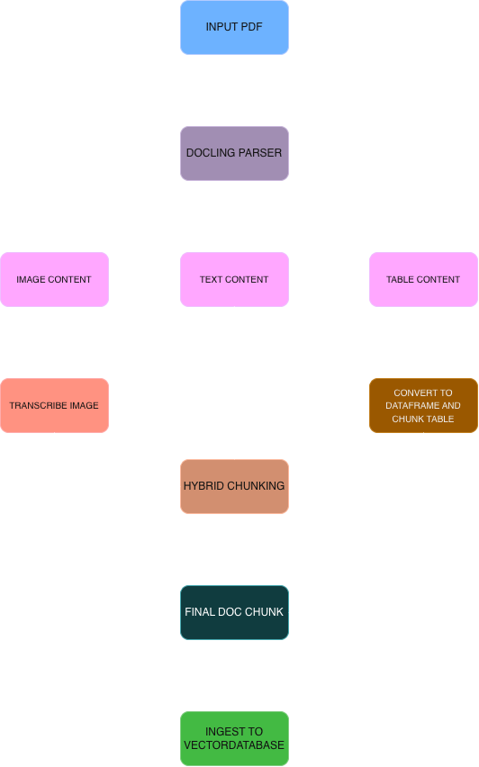

# RAG Agent

A Retrieval-Augmented Generation (RAG) project that lets you chat with your PDF documents. It parses PDFs with layout awareness (text, tables, and figures), indexes them in a hybrid dense + sparse vector store, and answers questions with an LLM agent that cites its sources.

The repository shows the project's evolution in three versions:

| Version | Folder | What it is | LLM / Embeddings |
|---|---|---|---|
| V1 | `V1_ollama/` | Fully local notebooks (Ollama) | `qwen3:8b` / `bge-m3` via Ollama |
| V2 | `V2_openai/` | Notebooks using OpenAI, with an agentic retrieval tool | `gpt-6-luna` / `text-embedding-3-small` |
| V3 | `V3_RAG_AGENT_APP/` | Streamlit chat app built on the V2 pipeline | `gpt-6-luna` / `text-embedding-3-small` |

V3 is the most complete version and the recommended starting point.

All three versions share a single root-level `requirements.txt` file for dependency management.



## Repository layout

```text
RAG_AGENT/
├── requirements.txt            # Shared dependencies for V1, V2, and V3
├── ingestion_pipeline.png      # Ingestion flow diagram
├── V1_ollama/                  # Local (Ollama) notebooks
│   ├── Step_1_Ingestion_flow_qdrant.ipynb
│   ├── Step_2_Naive_RAG.ipynb  # LangGraph retrieve -> answer pipeline
│   └── rag_paper.pdf           # Sample document
├── V2_openai/                  # OpenAI notebooks
│   ├── Step_1_Ingestion_flow_qdrant.ipynb
│   ├── Step_2_Agentic_RAG.ipynb  # Agent with a retrieval tool
│   └── rag_paper.pdf
└── V3_RAG_AGENT_APP/           # Streamlit application
    ├── app.py                  # Streamlit UI, session state, chat loop
    ├── ingestion.py            # Builds the hybrid Qdrant vector store
    ├── document_parser.py      # Docling parsing, table/figure/text chunking
    ├── tools.py                # retrieve_docs tool for the agent
    ├── model.py                # LLM and embedding model loaders
    ├── constant.py             # UI CSS and agent system prompt
    └── rag_paper.pdf
```

## Getting started

### Prerequisites

- Python 3.11
- An OpenAI API key for V2 and V3
- For V1 only: [Ollama](https://ollama.com) running locally, with the `qwen3:8b` and `bge-m3` models pulled.

Install the Ollama models for V1:

```bash
ollama pull qwen3:8b
ollama pull bge-m3
```

### Install dependencies

Install the shared dependencies from the repository root:

```bash
python -m venv .venv
source .venv/bin/activate        # Windows: .venv\Scripts\activate
pip install -r requirements.txt
```

Use this same environment for V1, V2, and V3.

### Run the Streamlit app (V3)

From the repository root:

```bash
# Create a .env file inside V3_RAG_AGENT_APP
echo OPENAI_API_KEY=your-key-here > V3_RAG_AGENT_APP/.env

# Launch the application
streamlit run V3_RAG_AGENT_APP/app.py
```

Alternatively, change into the application directory before launching it:

```bash
cd V3_RAG_AGENT_APP
streamlit run app.py
```

Then open the URL Streamlit prints, usually `http://localhost:8501`.

1. Upload one or more PDFs in the sidebar.
2. Click **Create Knowledge Base**. Ingestion can take a while, especially for PDFs with many figures, because each figure is sent to the LLM for transcription.
3. Ask questions in the chat box.

Use **New chat** to clear the conversation, or **Reset knowledge base** to remove the indexed documents.

### Run the notebooks (V1 / V2)

1. Install the shared dependencies from the repository root, as described above.
2. For V2, configure `OPENAI_API_KEY` in a `.env` file in `V2_openai/`.
3. Open the notebook for the version you want to run:
   - V1: `V1_ollama/Step_1_Ingestion_flow_qdrant.ipynb`, followed by `V1_ollama/Step_2_Naive_RAG.ipynb`.
   - V2: `V2_openai/Step_1_Ingestion_flow_qdrant.ipynb`, followed by `V2_openai/Step_2_Agentic_RAG.ipynb`.

Run the ingestion notebook first to build the index, then run the second notebook to ask questions.

## Configuration

| Setting | Where | Default |
|---|---|---|
| Dependencies | `requirements.txt` in the repository root | Shared across all versions |
| `OPENAI_API_KEY` | `.env` in the relevant app or notebook folder | Required for V2 and V3 |
| Chat model | `load_llm()` in `V3_RAG_AGENT_APP/model.py` | `gpt-6-luna`, with `reasoning_effort="none"` |
| Embedding model | `load_embedding_model()` in `V3_RAG_AGENT_APP/model.py` | `text-embedding-3-small`, 1024 dimensions |
| Table chunk size | `create_langchain_documents()` in `document_parser.py` | 10 rows per chunk |
| Text chunk size | `HybridChunker` in `document_parser.py` | 512 tokens |
| Figure filter thresholds | `is_relevant_picture()` in `document_parser.py` | Minimum 100 × 80 px and 12,000 px² area |
| Search depth (`k`) | Agent system prompt in `constant.py` | 4 by default, 6–8 for broad questions |

## Notes and limitations

- **Shared dependencies:** All versions use the root-level `requirements.txt`. Install dependencies from the repository root.
- **Vector store is in memory:** The V3 app builds a new Qdrant collection for each upload and discards it when the app restarts. Nothing is persisted between sessions.
- **Figure transcriptions are machine-generated:** Values read from charts may be approximate. The agent is instructed to say so.
- **Scanned PDFs:** Docling's OCR is slower and less accurate than parsing native text.
- **Keep your API key out of version control:** Add `.env` to `.gitignore` before pushing.
- **V2 notebook mismatch:** The V2 Step 2 notebook imports `langchain_chroma`, but ingestion stores vectors in Qdrant. The V3 app uses Qdrant throughout.

## Tech stack

- [Docling](https://github.com/docling-project/docling): PDF parsing, OCR, table and figure extraction, hybrid chunking
- [LangChain](https://www.langchain.com/) and LangGraph: agents, tools, and retrieval
- [Qdrant](https://qdrant.tech/) (`qdrant-client`, `langchain-qdrant`): hybrid dense + sparse vector search
- [FastEmbed](https://github.com/qdrant/fastembed): BM25 sparse embeddings
- [OpenAI](https://platform.openai.com/) and [Ollama](https://ollama.com): LLM and embedding providers
- [Streamlit](https://streamlit.io/): chat UI

## Sample data

Each version includes `rag_paper.pdf`, a research paper you can use to try the pipeline without additional document preparation.
